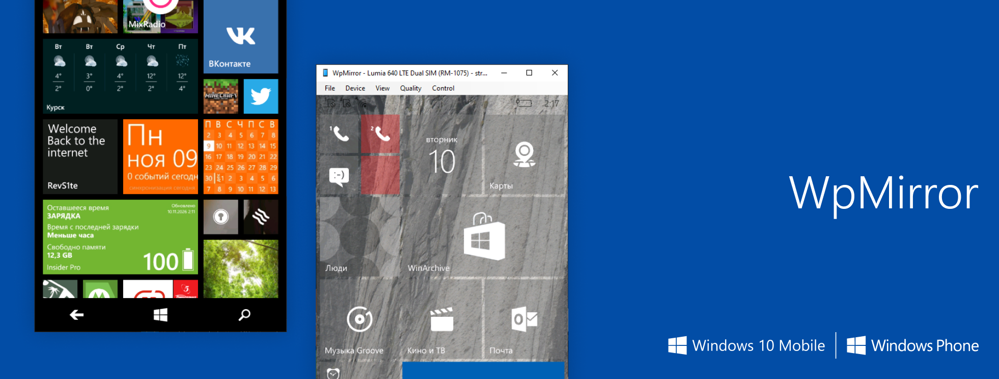

# WpMirror

Application for displaying the screen of Windows Phone and Windows 10 Mobile devices

## Features

- Live USB screen mirroring using RGB565 frames (typically 450×800 on a Lumia 830).
- **Device** menu listing currently connected phones. The streaming window remains empty until a device is selected.
- Screenshots and copy-frame-to-clipboard support.
- Image rotation, always-on-top mode, and fit-to-frame window sizing.
- Automatic reconnection with a cooldown between sessions.
- Experimental mouse-to-touch input.
- **Set up** action for phones whose display interface has not been registered by Windows.
- USB troubleshooting report (**Help > Save USB report**).

## Requirements

- Windows 10 or later (tested on Windows 10 22H2, 64-bit).
- .NET Framework 4.x (included with Windows 10).
- An unlocked Windows Phone 8.1 Lumia or Windows 10 Mobile phone connected over USB.
- A WinUSB driver exposing the phone's additional USB interfaces. This is the same driver used by Microsoft's original **Project My Screen** tool, usually installed with the Windows Phone SDK or Project My Screen.

In Device Manager, the additional interfaces should appear as **WinUSB device**.

## Build

Place `Program.cs`, `Usb.cs`, and `build.cmd` in the same folder and run `build.cmd`.

The application is compiled using the C# compiler included with .NET Framework:

```cmd
csc /target:winexe /out:WpMirror.exe /r:System.dll /r:System.Core.dll /r:System.Drawing.dll /r:System.Windows.Forms.dll Program.cs Usb.cs
```

---

## How it works

### 1. USB connection and device layout

Windows detects a Lumia as a USB composite device with one of the following vendor IDs:

- `0x0421` — Nokia.
- `0x045E` — Microsoft.

A composite device exposes multiple independent interfaces through a single physical USB connection. Each interface handles a different function.

| Interface | Purpose |
|---|---|
| MI_00 | MTP — file transfer |
| MI_01 | IP over USB — used by developer tools |
| MI_02 | **Screen projection** (Bulk IN `0x84`, Bulk OUT `0x03`) |
| MI_03 | Another vendor interface, inactive during projection |

Interfaces MI_01–MI_03 use the WinUSB driver.

Windows exposes each interface to applications through a special device interface path. For example:

```text
\\?\usb#vid_0421&pid_06fc&mi_02#<instance>#{31648E59-6FCB-4D81-9C97-D00999B0459A}
```

WpMirror opens the MI_02 interface using `CreateFile`, initializes WinUSB with `WinUsb_Initialize`, and communicates directly with the phone through USB control and bulk transfers.

All required native USB functions are accessed through P/Invoke declarations in `Usb.cs`.

### 2. Finding connected phones

The **Device** menu is refreshed every time it is opened.

WpMirror uses multiple discovery methods because different phone models may register their USB interfaces differently in Windows.

The discovery process:

1. Uses `SetupDi*` functions to enumerate present interfaces for known GUIDs. These include the standard GUID and additional GUIDs found in the registry under `Enum\USB\VID_0421/045E...\Device Parameters`.
2. Checks interfaces registered by Windows under `Control\DeviceClasses`. Their connection status is verified using `CM_Locate_DevNode`.
3. Keeps only MI_02 interfaces, which are responsible for screen projection.
4. Removes duplicates so each physical phone appears only once.

The device name displayed in the menu comes from the `FriendlyName` value stored in the Windows registry.

Bulk IN / Bulk OUT endpoint addresses and the interface number are obtained from the USB interface descriptor using `WinUsb_QueryInterfaceSettings` and `WinUsb_QueryPipe`. If these values cannot be retrieved, Lumia 830 values are used as a fallback.

### 3. Starting screen projection

After a phone is selected, WpMirror opens its MI_02 interface and sends a USB class request with the following parameters:

- `bmRequestType = 0x21`
- `bRequest = 0x02`
- `wIndex` = interface number.
- No data stage.

This request tells the phone to start screen projection.

The phone then displays the system prompt **"Allow screen projection?"**. Once the user taps **Yes**, the phone starts sending frames through Bulk IN endpoint `0x84`.

To keep the connection alive, the original Project My Screen application sends class request `0x03` twice every 2.5 seconds. WpMirror follows the same behavior using an identical keep-alive mechanism.

When a session ends, WpMirror sends class request `0x01`. This matches the final request observed when analyzing USB traffic from the original application.

### 4. Frame format and image decoding

The phone sends binary messages consisting of a header followed by image data.

All numeric header fields use Little-endian byte order.

| Offset | Size | Description |
|---|---|---|
| 0 | 4 bytes | Magic: `0x44555608` |
| 4 | 4 bytes | Message type (`2` = frame) |
| 8 | 4 bytes | Total message size |
| 24 | 4 bytes | Bits per pixel (16 on tested devices) |
| 28 | 4 bytes | Row stride in bytes |
| 32 | 2 + 2 bytes | Phone screen width and height |
| 36 | 2 + 2 bytes | Frame width and height |

Pixel data is located at the end of the message. Its starting offset is calculated as follows:

```text
pixel_offset = total_message_size - stride * frame_height
```

On tested devices, the header size is 512 bytes.

The image uses **RGB565, Little-endian** encoding. Each pixel occupies 16 bits: 5 bits for red, 6 bits for green, and 5 bits for blue.

If the reported stride is zero or smaller than `width * bytes_per_pixel`, WpMirror assumes tightly packed rows without additional padding. The effective stride is then:

```text
stride = width * bytes_per_pixel
```

Examples:

- Lumia 830: 450×800 frames for a 720×1280 screen.
- Lumia 532: 480×800 frames for a 480×800 screen.

USB data is read on a separate background thread.

A single USB read does not necessarily return a complete message: data may arrive in multiple chunks, or several messages may be received in one buffer. WpMirror therefore accumulates incoming data and extracts individual messages by searching for the starting magic value `0x44555608`.

Frames are then decoded and converted into `Bitmap` objects on the background thread before being passed to the UI thread for display.

If the UI cannot process frames fast enough, outdated frames are dropped instead of being queued. This keeps the displayed image as close as possible to the phone's current screen without gradually increasing latency.

### 6. Phones without a registered interface

On some phones, Windows successfully binds the WinUSB driver to MI_02 but does not create a Device Interface for it.

This happens when the interface GUID is missing from the `Device Parameters` registry key of the corresponding device instance.

Without a registered Device Interface, an application cannot obtain the device path required to open it through `CreateFile`.

The **Set up** action automatically fixes this issue:

1. Writes the standard `DeviceInterfaceGUID` value to the corresponding device instance's registry parameters.
2. Disables the MI_02 device node using `CM_Disable_DevNode`.
3. Re-enables it using `CM_Enable_DevNode`.

Disabling and re-enabling the device forces Windows to re-enumerate the interface and register its device path.

Administrator privileges are required. This setup usually needs to be performed only once per phone.

If Windows fails to restart the device, unplug the USB cable and reconnect the phone.

### 7. Experimental touch input

WpMirror supports experimental conversion of mouse actions into touchscreen events on the phone.

It uses the same USB interface and a message format reverse-engineered from USBPcap captures of the original Project My Screen application.

The process works as follows:

1. Sends class request `0x03`.
2. Sends a 192-byte message through Bulk OUT endpoint `0x03`.
3. The message contains magic `0x44555608` and message type `3`.
4. WpMirror uses message templates obtained from USB captures of the original application and patches the required fields: stroke ID, event phase (`down`, `move`, `up`), and coordinates.

Coordinate mapping from the application window to the phone screen is approximate.

The message structure and coordinate handling have not been verified on other phone models.

Touch input is experimental and may not work correctly on every device.
